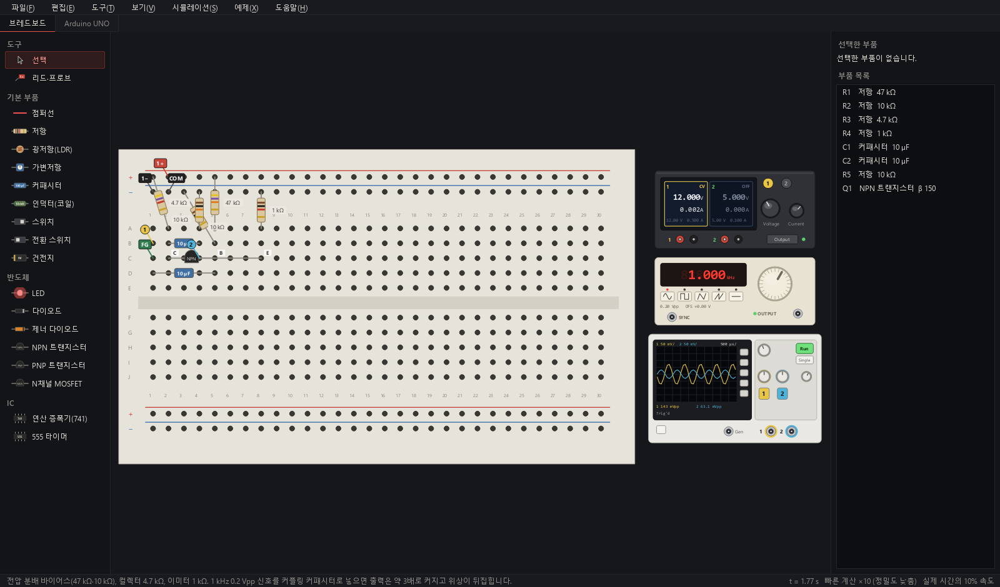
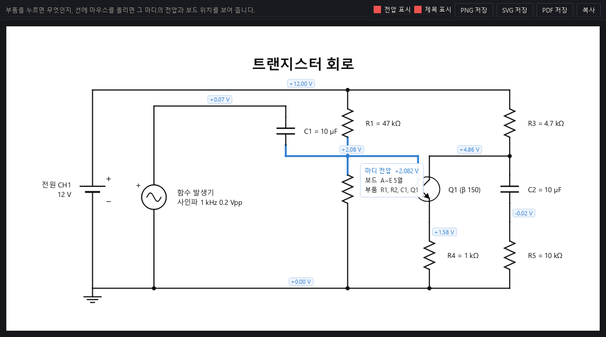
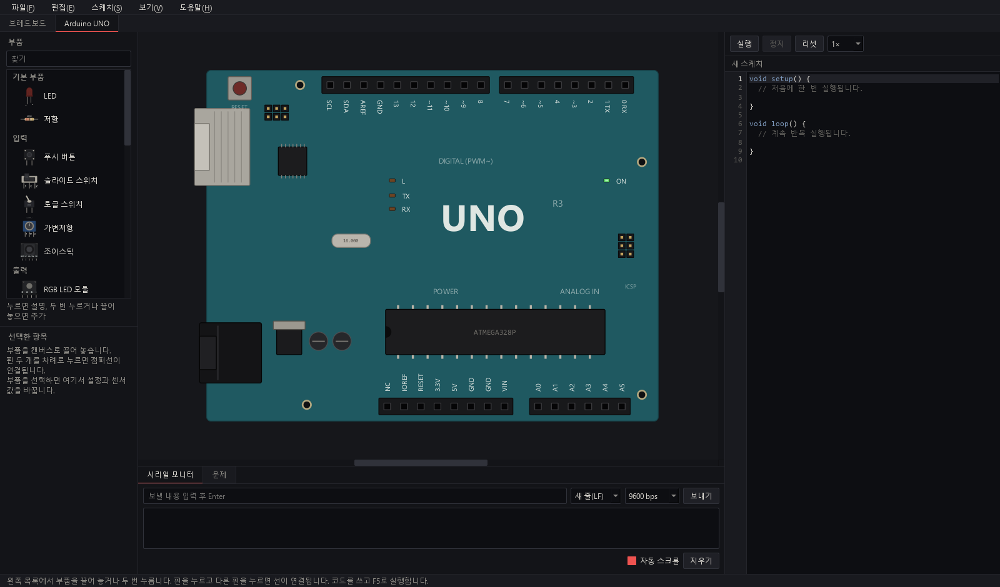

# BreadLab

브레드보드에 부품을 꽂아 회로를 만들고, 실험실에서 쓰는 계측 장비로 전압과 파형을 측정해 보는 회로 실습 프로그램입니다. LED 하나 켜는 것부터 트랜지스터 증폭기, 연산 증폭기까지 같은 화면에서 다룹니다. 다른 탭에서는 가상 Arduino UNO에 센서와 모듈을 연결하고 스케치를 실행해 볼 수 있습니다.

처음 쓰는 학생도 설명서 없이 시작할 수 있게 만들었습니다. 왼쪽에서 부품을 고르고 구멍 두 개를 클릭하면 꽂히고, 전원을 켜면 곧바로 시뮬레이션이 시작됩니다. LED에 저항을 넣지 않았거나 전원이 단락되면 원인과 고치는 방법을 경고창으로 알려 줍니다.



## 할 수 있는 것

- **부품 19종**: 저항, 가변저항, 광저항, 커패시터, 인덕터, 스위치, 건전지, LED, 다이오드, 제너 다이오드, NPN·PNP 트랜지스터, MOSFET, 741 연산 증폭기, 555 타이머 등
- **계측 장비**: 2채널 전원 공급기, 함수 발생기, 2채널 오실로스코프. 실제 장비의 앞면을 본뜬 창에서 다이얼과 버튼으로 조작합니다.
- **회로도**: 보드에 꽂은 회로를 교과서 모양의 회로도로 자동으로 그립니다. 회로도의 선에 마우스를 올리면 그 마디(노드)의 전압과 브레드보드 위치가 표시되고, 보드에서도 같은 구멍이 함께 표시됩니다. PNG·SVG·PDF로 저장할 수 있습니다.
- **회로도 가져오기**: Falstad CircuitJS 회로 파일을 불러와 브레드보드에 자동으로 배치합니다.
- **예제 10개**: LED 켜기부터 연산 증폭기 반전 증폭기까지 쉬운 순서로 들어 있습니다.
- **Arduino UNO**: 스케치를 작성해 실행하면 앱 안에서 바로 동작합니다. 컴파일러를 따로 설치할 필요가 없습니다. 모듈은 25종입니다.
- **언어**: 한국어, 영어

계산은 교육용으로 단순화한 모델입니다. 실제 부품과 값이 조금 다를 수 있습니다.

| 회로도 | Arduino UNO |
|---|---|
|  |  |

## 설치와 실행

Python 3.10 이상이 필요합니다.

```powershell
py -m venv .venv
.venv\Scripts\python -m pip install -r requirements.txt
.venv\Scripts\python BreadLab.py
```

회로 파일을 인자로 주면 바로 엽니다: `python BreadLab.py 회로.bd`

실행 파일 만들기: `.venv\Scripts\python -m PyInstaller BreadLab.spec` (`dist\BreadLab\BreadLab.exe`)

## 브레드보드

- 왼쪽에서 부품을 고르고, 시작 구멍에서 끝 구멍까지 끌거나 두 구멍을 차례로 클릭해 꽂습니다.
- 3단자 부품은 세 구멍을 차례로 클릭합니다: 트랜지스터 C → B → E, MOSFET D → G → S, 가변저항 1 → 와이퍼 → 3,
  전환 스위치 A → COM → B. LED·다이오드·제너는 첫 구멍이 애노드, 건전지는 첫 구멍이 +입니다.
- IC(741 연산 증폭기, 555 타이머)는 1번 핀이 꽂힐 열을 한 번 클릭하면 가운데 홈을 걸쳐 꽂힙니다. 몸체를 끌면 통째로 옮깁니다.
- 선택한 부품의 다리 끝을 끌면 다른 구멍으로 옮깁니다. 스위치는 더블클릭으로 전환합니다.
- 구멍에 마우스를 올리면 전기적으로 이어진 구멍이 모두 표시되고 전압이 나옵니다(CH1 − 기준).
- 상단 A~E, 하단 F~J는 같은 번호 다섯 칸끼리 이어져 있습니다. 전원 레일 네 줄은 각각 가로로 끝까지 이어져 있습니다.
- 부품 값은 `330`, `4.7k`, `1M`(저항), `100u`, `47n`(커패시터)처럼 입력합니다. M은 메가, m은 밀리입니다.

부품(19종): 점퍼선, 저항, 광저항(LDR), 가변저항, 커패시터, 인덕터, 스위치, 전환 스위치(SPDT), 건전지,
LED(5색), 다이오드, 제너 다이오드, NPN·PNP 트랜지스터, N채널 MOSFET, 연산 증폭기(741), 555 타이머.

## 장비

장비는 리드선 끝의 집게(오실로스코프는 프로브)를 보드 구멍에 물려 연결합니다. 왼쪽 '리드·프로브 연결' 도구에서 리드를 고르고 구멍을 클릭하거나, 각 장비 창의 '꽂기'·'프로브' 버튼을 누른 뒤 구멍을 클릭합니다. 같은 구멍을 다시 클릭하거나 집게 표시를 우클릭하면 뗍니다.

보드 왼쪽의 장비 상자에는 현재 출력값, 집게 위치, 작은 파형이 나옵니다. 상자를 클릭하면(또는 왼쪽 '장비' 목록, 보기 메뉴 Ctrl+1/2/3) 장비 창이 따로 열리며, 창을 닫아도 장비는 계속 동작합니다.

| 장비 | 내용 |
|---|---|
| 전원 공급기 | 2채널, 채널마다 0~30 V / 1 mA~5 A. 부하 전류가 제한값을 넘으면 CC로 바뀌고 전압이 내려갑니다. CH2는 절연되어 있어 CH1 위에 직렬로 쌓을 수 있습니다. |
| 함수 발생기 | 사인·사각(듀티 조절)·삼각·톱니파, DC. 0.1 Hz~20 kHz, 최대 20 Vpp, 오프셋 ±10 V, 출력 임피던스 50 Ω. |
| 오실로스코프 | 2채널. V/div, 위치, AC 결합, Time/div, 트리거(소스·기울기·레벨, Auto/Normal/Single), Run/Stop, 자동 설정. Vpp·평균·RMS·주파수를 자동 측정합니다. 0.2 s/div 이상은 Roll 표시입니다. |

- CH1 −, 함수 발생기 COM, 오실로스코프 접지는 장비 안에서 이어진 공통 접지입니다.
- 회로 파일을 열면 모든 출력이 꺼진 상태로 시작합니다.
- 시간축을 빠르게 두면 계산 간격이 줄어 실시간보다 느리게 진행합니다. 보드 아래 상태 줄에 배율이 표시됩니다.
- 파일 메뉴에서 보드 이미지, 스코프 화면(PNG), 스코프 파형(CSV)을 저장할 수 있습니다.

## Arduino UNO

브레드보드와 별개인 가상 UNO 보드입니다. 왼쪽 목록에서 모듈을 끌어 놓고 핀끼리 클릭해 점퍼선으로 잇습니다.
오른쪽 편집기에 스케치를 쓰고 실행(F5)하면 앱 안의 해석기가 바로 실행합니다(컴파일러 설치 불필요).

- 모듈 25종: LED, 저항, RGB LED, 버튼·스위치, 가변저항, 조이스틱, 부저, 서보, DC 모터, 릴레이, LCD 1602, 7세그먼트, TM1637, 8×8 도트 매트릭스, 초음파·온습도·조도·PIR·기울기·소리·온도·IR 센서. 센서 값은 실행 중에 바꿀 수 있습니다.
- 문법: 변수·배열·함수·`#define`·`enum`·제어문·`String`, Arduino 기본 함수, `Serial`, 라이브러리 `Servo`, `LiquidCrystal_I2C`, `Wire`, `DHT`, `TM1637Display`, `LedControl`. `int`는 UNO처럼 16비트입니다.
- 지원하지 않음: 포인터(문자열 제외), `struct`·`class`, 템플릿, 부저 소리. 전기 해석은 논리 수준입니다.
- 저장 형식은 `.uno`입니다. 예제 12개가 들어 있습니다.

## 회로도

보기 › 회로도(Ctrl+4)를 누르면 보드 회로를 교과서식 회로도로 자동으로 그려 따로 창에 보여 줍니다. 회로를 고치면 바로 다시 그립니다.

- 회로도의 부품에 마우스를 올리면 빨갛게 표시되고, 누르면 오른쪽 카드에 그 부품이 무엇인지(하는 일), 다리 위치,
  지금 전압·전류, 경고가 나옵니다. 보드에서도 같은 부품이 선택되고, '보드에서 보기'로 보드 화면을 그 부품으로 옮깁니다.
  보드에서 고른 부품도 회로도에 표시됩니다. 스위치는 카드에서 전환하고, 가변저항·LDR은 카드의 손잡이로 바꿉니다.
- 사다리형 배치는 열 순서를 바꿔 가며 선끼리 엇갈림, 남의 기호·이름표를 지나는 선, 전체 선 길이가 가장 작은 배치를 고릅니다.
  이름표가 선이나 다른 글자에 걸리면 가장 가까운 빈자리로 옮깁니다. PDF는 A4 한 장에 맞춥니다.

- 전원 하나와 2단자 부품으로 된 회로는 직렬·병렬로 정리해, 전원을 왼쪽 세로에 두고 부품을 위·아래 줄로 나눈 사각 루프로 그립니다. 제목은 '직렬 회로 / 병렬 회로 / 직병렬 회로'로 자동으로 붙습니다.
- 트랜지스터처럼 직렬·병렬로 나뉘지 않는 회로는 + 레일을 위, 접지를 아래에 두고 직렬로 이어지는 부품을 한 세로줄에 쌓습니다. 갈라지는 마디에만 연결점(●)을 찍고, 아무 데도 이어지지 않은 끝은 ○로 표시합니다.
- 회로도 창 위쪽 버튼이나 파일 › 회로도 내보내기(Ctrl+E)로 PNG, SVG, PDF로 저장하거나 클립보드로 복사합니다.

## 회로도 파일 가져오기

파일 › 회로도 파일 가져오기(Ctrl+I)로 Falstad CircuitJS 회로 파일(.txt)을 읽어 브레드보드에 자동으로 꾸밉니다.

1. 해석: 파일에 적힌 부품 좌표로 다리 위치를 계산하고, 좌표·전선으로 이어진 다리를 묶어 넷리스트를 만듭니다.
2. 대응: 교류 전원은 함수 발생기, 접지 기준 직류는 전원 CH1, 다음 직류는 CH2(음전원이면 거꾸로 연결), 나머지는 건전지로 넣습니다.
   연산 증폭기의 ±15 V처럼 회로도에 숨은 전원도 꺼내 붙이고, 커패시터·인덕터의 처음 상태도 가져옵니다.
3. 배치: 접지·전원은 레일, IC는 가운데 홈, 트랜지스터는 이웃한 세 열, 나머지 마디는 세로 다섯 칸 줄을 하나씩 받습니다.
   줄이 모자라면 옆 줄을 점퍼선으로 잇습니다. 여러 배치안 가운데 다리·점퍼선이 덜 엇갈리고 짧은 것을 고릅니다.
4. 검증: 보드 연결을 다시 계산해 원래 넷리스트와 마디가 1:1로 맞는지 확인하고, 맞지 않으면 가져오지 않습니다.

`circuits_web/`에는 시험용으로 받은 교육용 회로도 41개가 있습니다(출처: Falstad CircuitJS 예제, github.com/sharpie7/circuitjs1, GPL-2.0).
시험에만 쓰며 실행 파일에는 넣지 않습니다.

## 위험 경고

단락(쇼트)이나 부품이 망가질 상태(정격 초과, LED 과전류, 역전압 등)가 새로 생기면 경고창을 띄워 원인과 고치는 법을 알려 줍니다.
경고창에서 바로 모든 출력을 끌 수 있습니다. 같은 문제는 사라졌다가 다시 생길 때만 다시 알립니다.
시뮬레이션 › '단락·부품 손상 경고창 띄우기'로 끌 수 있습니다.

## 언어

도움말 › 언어 · Language에서 한국어와 English를 고릅니다. 다시 시작하면 적용됩니다. 처음 실행할 때는 시스템 언어를 따릅니다.
번역표는 `i18n_en.json`이고, `test_i18n.py`가 화면 문구 가운데 번역이 빠진 것이 없는지 확인합니다.

## 경고 기준

저항·LDR 정격 전력, LED 순방향 20 mA·역전압 5 V, 다이오드 1 A·역전압 50 V·1 W, 스위치 500 mA,
커패시터 정격 전압, NPN 컬렉터 200 mA·625 mW·V_CE 40 V. 경고가 있는 부품에는 빨간 표시가 붙습니다.

## 계산 모델

교육용 단순 모델이며 SPICE를 대신하지 않습니다.

- 전선과 보드 내부 연결은 하나의 노드로 합친 뒤 노드 전압법과 Newton 반복으로 풉니다.
- 커패시터는 후진 오일러, 다이오드·LED는 Vf + 직렬 저항(꺾임점 5 mV 완화), NPN·PNP는 단순화한 β 모델(V_BE 약 0.7 V), MOSFET은 제곱 법칙, 연산 증폭기는 이득 10⁵·출력 50 Ω, 555는 비교기 두 개와 플립플롭 모델입니다.
- 모든 노드에 10 nF 기생 용량이 있습니다. 트랜지스터가 상태를 뒤집는 순간처럼 계산이 수렴하지 않으면 시간 간격을 최대 4⁹분의 1까지 나눠 넘어갑니다.
- 오실로스코프 입력 저항은 10 MΩ입니다.
- 반도체 역방향 항복, 온도, 부품 오차, 접촉 저항은 다루지 않습니다.

## 파일 구성

| 파일 | 내용 |
|---|---|
| `BreadLab.py` | 메인 창, 작업 공간 탭, 도움말 |
| `breadboard.py` | 브레드보드 작업 공간 |
| `schematic.py`, `schematic_window.py` | 회로도 자동 배치·그리기·내보내기, 부품을 눌러 보는 회로도 창 |
| `circuit_import.py` | 회로도 파일 가져오기(해석·대응·배치·검증) |
| `i18n.py`, `i18n_en.json` | 화면 언어와 영어 번역표 |
| `instruments.py` | 전원 공급기·함수 발생기·오실로스코프 창의 내용 |
| `circuit_core.py` | 부품 데이터, 파일 검증, 회로 해석(Qt 비의존) |
| `examples.py` | 예제 회로 |
| `theme.py`, `workspace.py` | 공통 디자인과 작업 공간 규약 |
| `arduino_lab/` | Arduino UNO 작업 공간 |

회로 파일(`.bd`)은 JSON입니다. 예전 버전 파일(+/GND 구멍 지정 방식, 장비 단자에 꽂은 점퍼선)도 열 수 있으며, 열 때 리드 연결로 바뀝니다.

## 단축키

F1을 누르면 현재 탭의 도움말이 열립니다(브레드보드는 사용법과 단축키 전체, Arduino UNO는 둘러보기).

| 구분 | 키 |
|---|---|
| 공통 | Ctrl+N 새로 만들기 · Ctrl+O 열기 · Ctrl+S 저장 · Ctrl+Z 실행 취소 · Ctrl+Y / Ctrl+Shift+Z 다시 실행 · Del / Backspace 삭제 · Esc 취소 · Ctrl+0 화면 맞춤 · F5 실행/일시정지 · Ctrl+Shift+F5 리셋 · Ctrl+Tab 탭 전환 · Ctrl+Q 끝내기 |
| 브레드보드 도구 | V 선택 · P 리드·프로브 · W 점퍼선 · R 저항 · Shift+R 광저항 · K 가변저항 · C 커패시터 · Shift+L 인덕터 · S 스위치 · Shift+S 전환 스위치 · B 건전지 · L LED · D 다이오드 · Shift+D 제너 · Q NPN · Shift+Q PNP · M MOSFET · A 연산 증폭기 · T 555 타이머 |
| 브레드보드 기타 | Ctrl+I 회로도 파일 가져오기 · Ctrl+4 회로도 · Ctrl+E 회로도 내보내기 · Space 스위치 전환 · Ctrl+1/2/3 전원·함수 발생기·오실로스코프 창 · F8 모든 출력 끄기 · F9 스코프 Run/Stop · F4 스코프 자동 설정 |

배치 도구를 쓰다가 빈 곳을 우클릭하면 선택 도구로 돌아갑니다.

## 테스트

```powershell
.venv\Scripts\python -m unittest -v test_circuit.py test_arduino.py test_schematic.py test_import.py test_i18n.py
.venv\Scripts\python e2e_test.py
.venv\Scripts\python e2e_uno.py
```

`e2e_test.py`(브레드보드)와 `e2e_uno.py`(Arduino UNO)는 화면 없이 앱을 띄워 실제 마우스·키보드 입력으로 부품 설치, 옮기기, 실행 취소, 리드 연결, 전원·스코프, 저장·열기, 단축키, 탭 전환, 스케치 실행·시리얼·예제 전체 실행을 확인합니다.
